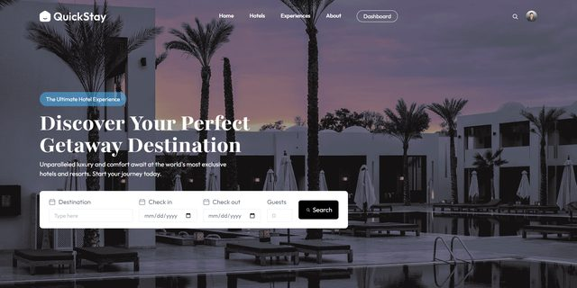
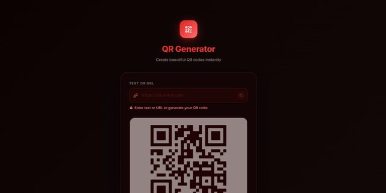
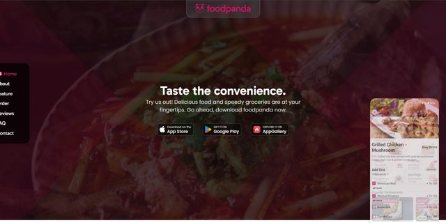
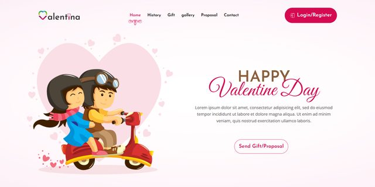

<!-- Hero: theme-aware animated banner (pure SVG + CSS, generated from the portfolio's colors) -->
<a href="https://my-portfolios-jade-one.vercel.app/" target="_blank" rel="noopener noreferrer">
  <picture>
    <source media="(prefers-color-scheme: dark)" srcset="./assets/hero-dark.svg">
    <source media="(prefers-color-scheme: light)" srcset="./assets/hero-light.svg">
    
  </picture>
</a>

  
  
  
  

INTRODUCTION

## About Me.

- 🎓 B.Sc. in **CSE** student at **University of Asia Pacific** (2024 – present)
- 🛠️ Trained in **Professional MERN Stack Development** and **Web Design** at **Creative IT Institute**
- 🚀 I build modern, scalable web apps with **React, Node.js, Express and MongoDB**, plus 3D on the web with **Three.js**
- 🏆 Regular participant in university **AI hackathons**
- 📍 Dhaka, Bangladesh

MY TECH STACK

## Skills & Technologies.

  <picture>
    <source media="(prefers-color-scheme: dark)" srcset="https://skillicons.dev/icons?i=html%2Ccss%2Cjs%2Creact%2Ctailwind%2Cbootstrap%2Cnodejs%2Cexpress%2Cmongodb%2Cthreejs%2Cvite%2Cgit%2Cgithub%2Cvercel%2Cfigma%2Cps%2Cai&perline=9&theme=dark">
    <source media="(prefers-color-scheme: light)" srcset="https://skillicons.dev/icons?i=html%2Ccss%2Cjs%2Creact%2Ctailwind%2Cbootstrap%2Cnodejs%2Cexpress%2Cmongodb%2Cthreejs%2Cvite%2Cgit%2Cgithub%2Cvercel%2Cfigma%2Cps%2Cai&perline=9&theme=light">
    
  </picture>

MY PROJECTS SHOWCASE

## Projects.

<table>
  <tr>
    <td width="33%" valign="top">
       
      <b>Etrail Global</b> 
      Live e-commerce marketplace (frontend) 
      <code>HTML</code> <code>CSS</code> <code>JS</code> 
      <a href="https://www.etrailglobal.com/">Live</a> · <a href="https://github.com/debodipto/Etrail_Global">Code</a>
    </td>
    <td width="33%" valign="top">
       
      <b>Hotel Booking App</b> 
      Responsive booking UI in React 
      <code>React</code> <code>Tailwind</code> 
      <a href="https://hotel-booking-app-2opy.vercel.app/">Live</a> · <a href="https://github.com/ps-sifat/Hotel-Booking-App">Code</a>
    </td>
    <td width="33%" valign="top">
       
      <b>QR Code Generator</b> 
      Custom QR codes with PNG download 
      <code>React</code> <code>Vite</code> 
      <a href="https://qr-code-generator-lilac-gamma.vercel.app/">Live</a> · <a href="https://github.com/ps-sifat/QR-code-generator">Code</a>
    </td>
  </tr>
  <tr>
    <td width="33%" valign="top">
       
      <b>Food Panda Landing Page</b> 
      Web contest entry, built by a team of two 
      <code>HTML</code> <code>CSS</code> <code>JS</code> 
      <a href="https://food-panda-app-landing-page-for-web.vercel.app/">Live</a> · <a href="https://github.com/ps-sifat/Food-Panda-app-landing-page-for-Web-Contest-Creative-IT-Institute-">Code</a>
    </td>
    <td width="33%" valign="top">
       
      <b>Valentina: PSD to HTML</b> 
      Fully responsive PSD conversion 
      <code>HTML</code> <code>CSS</code> 
      <a href="https://ps-sifat.github.io/valentina_psd_full_responsive_project/">Live</a> · <a href="https://github.com/ps-sifat/valentina_psd_full_responsive_project">Code</a>
    </td>
    <td width="33%" valign="middle" align="center">
      <b>More on GitHub</b>  
      
    </td>
  </tr>
</table>

MY PROFESSIONAL TRAINING

## Training.

| | Program | Institute | Period |
|:-:|---|---|---|
| 💻 | **Professional MERN Stack Development**: React, Node.js, Express, MongoDB, REST APIs with JWT auth, Vercel deployment | Creative IT Institute | Nov 2023 – Nov 2024 |
| 🎨 | **Professional Web Design**: UI/UX, responsive layouts, Flexbox and Grid, Figma, Photoshop, Illustrator | Creative IT Institute | Aug 2023 – Nov 2023 |
| 🖥️ | **Software Application Course** | Postal Academy | 2022 |

MY ACADEMIC HISTORY

## Education.

| Degree | Institution | Year | Focus |
|---|---|---|---|
| **B.Sc. in Computer Science & Engineering** | University of Asia Pacific | 2024 – Present | Algorithms, Data Structures, Database Systems, Software Engineering, AI |
| **Diploma in Computer Technology** | Patuakhali Polytechnic Institute | 2019 – 2023 | Hardware, Operating Systems, Programming, Networks, Databases, Web Technologies |
| **SSC (Science)** | Govt. Swarupkathi Pilot Secondary School | 2019 | Mathematics, Physics, Chemistry, ICT |

COMPETITIVE CODING & ACHIEVEMENTS

## Achievements & Activities.

- 🏅 **President Scout Award**: the highest recognition in the Bangladesh Scout movement
- 🤖 **SUST CSE Carnival 2026 AI Hackathon** (team ASOFT): built an AI-assisted FinTech solution with smart budget analytics
- ⚡ **DUET CSE Carnival 2026 AI Hackathon**: Dhaka University of Engineering & Technology, Gazipur
- 🧩 **DEVFUSION Mini Hackathon 2026** (team ASOFT): Software & Hardware Club, CSE, University of Asia Pacific
- 🛡️ **BUP CSE Tech Carnival 2025 Hackathon**: Bangladesh University of Professionals

MY GITHUB ACTIVITY

## GitHub Stats.

  <picture>
    <source media="(prefers-color-scheme: dark)" srcset="https://github-readme-stats.vercel.app/api?username=ps-sifat&show_icons=true&hide_border=true&bg_color=050816&title_color=915eff&icon_color=915eff&text_color=aaa6c3">
    <source media="(prefers-color-scheme: light)" srcset="https://github-readme-stats.vercel.app/api?username=ps-sifat&show_icons=true&hide_border=true&bg_color=e7e9f1&title_color=7c3aed&icon_color=7c3aed&text_color=4a4768">
    
  </picture>
  <picture>
    <source media="(prefers-color-scheme: dark)" srcset="https://github-readme-stats.vercel.app/api/top-langs/?username=ps-sifat&layout=compact&hide_border=true&bg_color=050816&title_color=915eff&text_color=aaa6c3">
    <source media="(prefers-color-scheme: light)" srcset="https://github-readme-stats.vercel.app/api/top-langs/?username=ps-sifat&layout=compact&hide_border=true&bg_color=e7e9f1&title_color=7c3aed&text_color=4a4768">
    
  </picture>

  <picture>
    <source media="(prefers-color-scheme: dark)" srcset="https://streak-stats.demolab.com/?user=ps-sifat&hide_border=true&background=050816&ring=915eff&fire=915eff&currStreakLabel=915eff&sideLabels=aaa6c3&dates=6b6a7a&currStreakNum=ffffff&sideNums=ffffff&stroke=151030">
    <source media="(prefers-color-scheme: light)" srcset="https://streak-stats.demolab.com/?user=ps-sifat&hide_border=true&background=e7e9f1&ring=7c3aed&fire=7c3aed&currStreakLabel=7c3aed&sideLabels=4a4768&dates=8b89a0&currStreakNum=1a1730&sideNums=1a1730&stroke=dfe2ec">
    
  </picture>

GET IN TOUCH

## Contact.

  
  
  
  
  
  

